<div align="center">

# CaptureKit

**Capture failed API requests in Chrome DevTools, sanitize them, and export developer-approved regression tests.**

[](https://developer.chrome.com/docs/extensions/develop/migrate)
[](.nvmrc)
[](tsconfig.json)
[](package.json)
[](package.json)
[](package.json)
[](package.json)
[](vitest.config.ts)

</div>

## Overview

CaptureKit is a local-first Chrome DevTools extension (Manifest V3). It observes the inspected tab's failed fetch/XHR responses, strips sensitive data, and generates deterministic regression tests that you review before downloading as a self-contained project.

An optional local companion extends the workflow to reviewed fixes: it opens GitHub issues, performs Gemini-backed source investigation, proposes minimal code patches, verifies them in isolation, and creates separately approved fix branches and draft pull requests. The companion runs on loopback only and never acts without explicit per-step approval.

The capture and test-export workflow runs fully offline without the companion. No integration publishes, uploads code, applies a patch, or modifies your working tree automatically. There is no hosted backend, database, or required extension permission.

## Features

- **Scoped network capture** of the inspected tab's completed fetch/XHR responses with HTTP status 400 to 599. Not browser-wide monitoring and not JavaScript error capture.
- **Conservative sanitization** of every HAR field: origins, credentials, query values, and unrecognized sensitive fields are removed. Only bounded JSON previews are retained; response bodies load on demand.
- **Deterministic test generation.** Expected status is supplied by the developer. Templates are fixed TypeScript; no AI output is involved. Every generated file is inspectable before download.
- **Self-contained export.** The ZIP has no dependency on this monorepo and includes `regression.test.ts`, `safety.ts`, `package.json`, `tsconfig.json`, `vitest.config.ts`, `.env.example`, `.gitignore`, and `README.md`.
- **Optional loopback companion** for GitHub issues, Gemini investigation, minimal patches, isolated verification, and approved fix branches or draft PRs.
- **Isolated verification** via Bubblewrap with private network/PID namespaces. If isolation is unavailable, application code does not run.

## Tech stack

| Area | Technologies |
| --- | --- |
| Extension UI | React 19, TypeScript (strict), Tailwind CSS 4, `lucide-react`, `useSyncExternalStore` |
| Build | Vite 8, `@vitejs/plugin-react`, `@tailwindcss/vite` |
| Demo API | Express 5, `tsx` |
| Companion | Express 5, Zod, `@google/genai`, `diff`, controlled `git`/`gh` processes, Bubblewrap |
| Export | `jszip`, deterministic Vitest templates |
| Tooling | ESLint, Prettier, Vitest, Playwright (Chromium) |

No database, authentication platform, hosted backend, or Docker is required.

## Prerequisites

- **Node** matching `engines` in `package.json`: `^22.13.0 || ^24.0.0 || >=26.0.0`. See [`.nvmrc`](.nvmrc).
- **npm** (the committed `package-lock.json` supports reproducible installs with `npm ci`).
- **Google Chrome / Chromium 120+** for the extension.
- **Companion only:** `gh` (GitHub CLI) and `bubblewrap`. Gemini features additionally require a `GEMINI_API_KEY` and `GEMINI_MODEL`.

## Installation

### One command (Windows, macOS, Linux)

The cross-platform launcher installs dependencies, builds the extension, and starts the demo API.

```bash
# macOS / Linux
./run.sh

# Windows (PowerShell)
./run.ps1
```

Options (forwarded to `scripts/run.mjs`):

| Option | Description |
| --- | --- |
| `--mode <buggy\|fixed>` | Demo server mode. Default `buggy`. |
| `--port <number>` | Demo server port. Default `4317`. |
| `--skip-install` | Skip the dependency install step. |
| `--skip-build` | Skip the extension build. |
| `--no-serve` | Install and build only; do not start the server. |
| `-h`, `--help` | Show usage. |

You can also invoke the launcher directly with Node:

```bash
node scripts/run.mjs --mode fixed
```

### Manual steps

```bash
npm ci
npm run build
npm run demo:buggy
```

1. Open `chrome://extensions`, enable **Developer mode**, then **Load unpacked** and select `apps/extension/dist`.
2. Open `http://127.0.0.1:4317`, then open DevTools and select the **CaptureKit** panel (it may be hidden under the `»` overflow menu).
3. Submit the synthetic investment, then select its `POST /api/investments` **422** failure.
4. Open **Test Builder**, supply expected status **201**, review the exact exported files, and download the ZIP.
5. In the extracted project run `npm install`, copy `.env.example` to `.env`, set `TEST_BASE_URL=http://127.0.0.1:4317`, then run `npm run typecheck` and `npm test`.
6. The test fails against buggy mode. Stop that server, run `npm run demo:fixed`, and rerun the unchanged exported test: it passes.

DevTools must be open to capture; requests completed before DevTools opened may be unavailable. Closing DevTools discards the capture session.

## Environment variables

Companion Gemini configuration lives in `apps/companion/.env` (copied from [`apps/companion/.env.example`](apps/companion/.env.example) and ignored by Git). Keys stay in the companion process and are never entered into the extension.

| Variable | Required | Description |
| --- | --- | --- |
| `GEMINI_API_KEY` | Companion AI features | Google AI Studio key. Server-side only. |
| `GEMINI_MODEL` | Companion AI features | A currently supported model from your account. No model is selected silently; an unavailable model produces an explicit error. |

Runtime variables used by the demo and exported tests:

| Variable | Used by | Description |
| --- | --- | --- |
| `DEMO_MODE` | `demo:buggy` / `demo:fixed` | `buggy` or `fixed`. Selected at process start; no remote toggle. |
| `PORT` | demo server | Demo API port. Defaults to `4317`. |
| `TEST_BASE_URL` | exported test project | Target base URL. No default; must be set before tests run. |

```bash
cp apps/companion/.env.example apps/companion/.env
# then set GEMINI_API_KEY and GEMINI_MODEL
```

## Development commands

| Command | Purpose |
| --- | --- |
| `npm run dev` | Browser UI preview at `/panel.html`. Capture and pairing require the installed extension. |
| `npm run demo:buggy` / `npm run demo:fixed` | Run the local test-generator demo in buggy or fixed mode. |
| `npm run typecheck` | `tsc --noEmit`. |
| `npm run lint` | ESLint over the repository. |
| `npm run format` / `npm run format:check` | Apply or check Prettier. |
| `npm test` | Extension and companion suites (`vitest run`); external providers are mocked. |
| `npm run test:red-green` | Generated-test demo with mode switching. |
| `npm run test:fix-demo` | Real source patch and isolated red/green checks against a labeled fixture. Not live Gemini. |
| `npm run test:browser` | Real Chromium capture, inspection, and ZIP export. |
| `npm run test:browser:companion` | Real browser pairing, approval, diff, sandbox verification, and issue UI; providers use test adapters. |
| `npm run build` / `npm run verify:build` | Production build / manifest and asset verification. |
| `npm run check` | Typecheck, lint, tests, and build. |
| `npm run companion:start -- --workspace /repo` | Companion with explicit workspace; execution disabled by default. |
| `npm run companion:dev -- --workspace /repo` | Watch-mode companion. Restarting invalidates sessions. |
| `npm run companion:check` | Typecheck and companion tests, including Bubblewrap checks. |

Before running browser tests, install the Chromium build once:

```bash
npx playwright install chromium
```

## Architecture

CaptureKit is a packaged Chrome extension, a synthetic demo server, and an optional local companion. Capture and deterministic export work without the companion.

```mermaid
flowchart LR
  A[Inspected tab: fetch/XHR] --> B[Chrome DevTools network API]
  B --> C[Hidden devtools.html]
  C --> D[Normalize + sanitize]
  D --> E[Bounded in-memory store]
  E --> F[React panel]
  F --> G[Developer defines expected behavior]
  G --> H[Validate + sanitize again]
  H --> I[Deterministic test template]
  I --> J[Review exact files]
  J --> K[ZIP download]
  K --> L[Developer runs Vitest]
  L --> M[Target guard]
  M --> N[Authorized local/test API]
```



### Repository structure

```text
apps/
  extension/
    public/manifest.json, icons/
    src/devtools/                  # Chrome DevTools API integration
    src/features/network-capture/  # Sanitized, bounded in-memory records
    src/features/test-builder/     # Deterministic tests and ZIP review
    src/features/integrations/     # Pairing, AI, diff, and GitHub UI
    src/components/, lib/
  demo-api/                        # Synthetic page and Express API
  companion/
    src/                           # Auth, workspace, GitHub, Gemini, patches,
                                   #   verification, and branch/PR operations
    tests/                         # Security, provider, Git, execution tests
packages/
  shared/                          # Capture types/sanitizer + Zod contracts
  test-generator/                  # Deterministic Vitest templates
scripts/                           # Build, packaging, red/green, browser checks
docs/                              # Architecture, security, setup, demo, testing
```

## Companion workflow

The companion exists because a DevTools extension cannot read arbitrary local repositories. It exposes a bounded, authenticated loopback API, not a shell endpoint.

```bash
# Install OS tools per your organization's package policy.
sudo apt install gh bubblewrap

# Authenticate GitHub independently. CaptureKit never asks for a password.
gh auth login --hostname github.com
gh auth status --hostname github.com
```

Authorize a repository root explicitly, then pair from the extension:

```bash
npm run companion:start -- --workspace /absolute/path/to/repository --verification demo-investments
```

The demo profile (`demo-investments`) expects `apps/demo-api/src/app.ts` and its `createDemoApp` export. For other repositories, omit `--verification demo-investments`: discovery, investigation, patch review, staging, and export remain available while execution stays blocked until a trusted profile exists.

The companion prints a single-use pairing code valid for five minutes. In the extension **Settings**:

1. Enter the companion port (default **4318**) and pairing code.
2. Click **Pair local companion** and approve Chrome's optional loopback access request.
3. Confirm the authorized workspace and connection status.

The session token stays in panel memory. Disconnecting clears companion session data and staged copies; restart the companion to issue a new code.

```mermaid
flowchart LR
  P[DevTools panel] -->|Pairing + approvals| C[Loopback companion]
  C --> W[CLI-authorized Git workspace]
  W --> R[Bounded sanitized context]
  R -->|Approved context only| G[Gemini structured output]
  G --> D[Validated findings + exact diff]
  D -->|Stage approval| S[Temporary source snapshots]
  S -->|Execution approval| B[Bubblewrap baseline + patched checks]
  B -->|Passing report + local approval| L[Separate local Git branch]
  L -->|Push approval| H[GitHub branch]
  C -->|Issue or PR draft approval| H
```



Each step is a separate, explicit approval: confirm a GitHub issue draft, investigate with AI, stage a patch in the sandbox, run verification, apply to a new local branch, push the branch, and open a draft PR. No force-push, direct push to the base branch, merge, or automatic issue closure is provided.

See [AI investigation](docs/AI_INVESTIGATION.md), [code-fix workflow](docs/CODE_FIX_WORKFLOW.md), [GitHub setup](docs/GITHUB_INTEGRATION.md), [local companion details](docs/LOCAL_COMPANION.md), and the [demo script](docs/DEMO_SCRIPT.md).

## Security boundaries

- No required extension permissions or host access. Optional `http://127.0.0.1/*` is requested only for pairing. The CSP permits only loopback connections, not GitHub or Gemini directly.
- Capture removes origins, credentials, query values, and unrecognized sensitive fields. Only bounded JSON previews are retained.
- The companion binds `127.0.0.1` only, checks Host and extension origin, requires a random expiring session token and fresh request IDs, and rejects replayed writes.
- Workspace access is CLI-authorized, canonicalized, tracked-file-only, bounded, and symlink-checked. Secrets, dependency directories, build artifacts, hidden files, and trust-boundary paths are excluded.
- The model receives only reviewed context and has no execution tools. Outputs must match schemas, real source quotations, exact file hashes, and bounded minimal edits.
- Verification uses Bubblewrap with private network/PID namespaces, no inherited credentials, read-only source and dependencies, fixed commands, bounded output, timeout, and cancellation. Without isolation, application code does not run.
- Git operations never reset, clean, check out over, or overwrite your working tree.

Redaction is conservative, not perfect. Review outbound content and use synthetic data. See the [full security policy](docs/SECURITY.md).

## Verification and limits

The capture workflow and the companion browser workflow have been tested in real Chromium. Automated tests exercise real isolated source repair and branch creation in temporary repositories. GitHub and Gemini use explicit test adapters in automation: no live Gemini success, real issue publication, remote push, or real PR creation is claimed. Those require your credentials, an authorized repository, approved source context, and explicit UI approvals.

Execution currently supports the documented Express investment demo profile. Generic Node/TypeScript source discovery is heuristic; arbitrary frameworks, databases, browser sessions, multipart/binary replay, and arbitrary project scripts are unsupported. A passing status assertion is limited evidence, not proof of complete application correctness. This is a single-user local developer tool, not a multi-tenant hardened execution service.

Before presenting, perform the native Chrome install and permission checks and the live-provider steps in [TESTING](docs/TESTING.md).

## Deployment

CaptureKit ships as an unpacked or packaged Chrome extension; there is no server to deploy.

```bash
npm run package
```

This builds the extension and writes `artifacts/capturekit-0.2.0.zip` with the manifest at the ZIP root. It does not install or publish the extension. The companion runs locally per developer and is never deployed to shared infrastructure. See the [Chrome Web Store checklist](docs/CHROME_WEB_STORE.md).

## Troubleshooting

- **No failures captured:** open DevTools before triggering the request, resume capture, and clear filters. Network status 0, cancellation, and CORS-only errors are outside HTTP capture.
- **Pairing unavailable:** restart the companion, use its new code within five minutes, verify the port, and approve the optional loopback permission. Only one extension session is allowed per companion process.
- **Source missing:** use the Git root with tracked, non-ignored source files. Protected, oversized, or secret-bearing files cannot be patched.
- **Verification blocked:** install and configure Bubblewrap and unprivileged namespaces. Do not fall back to host execution.
- **GitHub failed:** check `gh auth status`, repository issue settings and access, and rate limits.
- **Stale patch or base:** regenerate from current source. Do not force-apply or force-push.
- **Missing Git identity:** configure a repository-local `user.name` and `user.email` before creating a local commit.
- **Changes not visible:** rebuild, reload the extension on `chrome://extensions`, close and reopen DevTools, then re-pair if needed.
